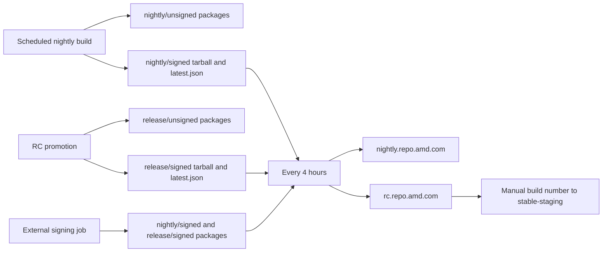

# Signed publish to the public repos

This document describes how a scheduled RVS build and a release-candidate promotion become a public extras-rvs repository behind `nightly.repo.amd.com`, `rc.repo.amd.com`, and stable-staging.

Two existing workflows prepare the RVS bucket. A third workflow, [publish-signed-public.yml](./publish-signed-public.yml), syncs the signed `packages/` and `tarball/` folders to the public buckets. The signing of rpm and deb packages happens in a separate job that is not in this repository.

## Flow



## What each workflow writes

The RVS bucket is `vars.AWS_S3_BUCKET`. These jobs assume `secrets.AWS_ROLE_ARN`. They accumulate objects and do not delete anything.

| Step | Workflow | Writes immediately | Left for the signing job |
|------|----------|--------------------|--------------------------|
| Scheduled default-branch nightly | [build-relocatable-packages.yml](./build-relocatable-packages.yml) | `nightly/unsigned/packages/deb/`, `nightly/unsigned/packages/rpm/x86_64/` and their repo metadata; `nightly/unsigned/tarball/` and `nightly/signed/tarball/` (`.tar.gz` and `.sha256`); `nightly/unsigned/latest.json` and `nightly/signed/latest.json` | rpm/deb bytes and repo metadata under `nightly/signed/packages/` |
| Manual RC promotion | [unsigned-release-candidate-promotion.yml](./unsigned-release-candidate-promotion.yml) | `release/unsigned/packages/` and `release/unsigned/tarball/`; the same tarball and sidecar on `release/signed/tarball/`; `release/unsigned/latest.json` and `release/signed/latest.json` | rpm/deb bytes and repo metadata under `release/signed/packages/` |

`nightly/unsigned/latest.json` and `release/unsigned/latest.json` stay the signing job's input. The signed `latest.json` files are the public publisher's checklist. Their tarball keys already point at `*/signed/tarball/`. Their deb and rpm keys point at `*/signed/packages/`, which are empty until the signing job copies them. Their `metadata` list names the full signed repo metadata the signing job must provide under `*/signed/packages/`:

- deb (`deb/dists/stable/`): `Release`, `InRelease`, `Release.gpg`, `main/binary-amd64/Packages`, `main/binary-amd64/Packages.gz`
- rpm (`rpm/x86_64/repodata/`): `repomd.xml`, `repomd.xml.asc`, `primary.xml.gz`, `filelists.xml.gz`, `other.xml.gz`

The signature files (`InRelease`, `Release.gpg`, `repomd.xml.asc`) are part of the gate, so an unsigned repo is never published.

## Public publish

[publish-signed-public.yml](./publish-signed-public.yml) runs on the cron `0 */4 * * *`. It can also be started manually with `run_number` left empty. A manual run has an optional `force` input (see "Published flag").

Every run syncs the whole signed prefix, not only the files named in `latest.json`. The signed `Packages` and `primary.xml.gz` also list older builds that are no longer in `latest.json`, so those older packages must be public too.

For `nightly/signed` and `release/signed` it:

1. Assumes `secrets.AWS_ROLE_ARN` and downloads that prefix's `latest.json` from the RVS bucket, together with its ETag. If the file is missing, the stream is skipped with a warning.
2. Reads the `published` flag. If it is `Yes`, the stream is skipped with the notice `the latest signed build ... is already published`, without listing any bucket (see "Published flag").
3. Validates the manifest. It must name at least one deb package, the rpm, the tarball and its sha256 sidecar. An empty or partial `latest.json` fails the stream. Every key must be normalized and sit under `<stream>/signed/packages/` or `<stream>/signed/tarball/`. A key with `..`, `.` or empty path segments, a backslash, a control character or a leading `/` fails the stream. A key that points at `<stream>/unsigned/` is mapped to the same path under `<stream>/signed/`. The required deb and rpm metadata and signature files are added to the list.
4. Gate: every mapped signed object (package, rpm, tarball, sha256 sidecar, metadata) must exist in the RVS bucket. Otherwise the stream is skipped with a warning, which means the signing job has not finished yet. It does not publish a partial set. The other stream still publishes when it is complete.
5. Lists the signed prefix (RVS role) and the public prefix (public role). Only keys under `packages/` and `tarball/` are considered. `latest.json`, the run folders and every other path are never listed and never published. Every listed key must pass the strict key check (a bad signed key fails the stream; a bad public key is ignored with a warning).
6. Checks that every package referenced by the signed `Packages` and `primary.xml.gz` is either in the signed prefix or already public. Otherwise the job fails with `Referenced package is missing from both the signed set and the public bucket`, because the public repository cannot be made complete.
7. Computes the delta. A file is copied when it is missing publicly, has a different size, or was modified in the signed prefix after the public copy was written (the same rule as `aws s3 sync`, so a re-signed file is copied again and an unchanged file never is). Nothing is ever deleted. If the delta is empty, the run logs the notice `No new or changed files for <stream>` and nothing is copied. This is not an error, because nightly and release builds run less often than this job.
8. Downloads the delta with the RVS role and uploads it unchanged with the public role, in an order that keeps the index valid for clients: first the packages, rpm, tarball and sidecar; then the other `packages/deb/dists/` and `packages/rpm/x86_64/repodata/` files; and last `Release`, `InRelease`, `Release.gpg`, `repomd.xml` and `repomd.xml.asc`. The data goes through the runner, so only the delta is transferred. The first run after the whole-prefix sync was introduced transfers the whole signed tree once.
9. Verifies that every copied file is now public with the signed size, and that every package referenced by the public index is public. A failure fails that stream.
10. Marks the build as published in the signed `latest.json` (see "Published flag").

**Published flag.** `nightly/signed/latest.json` and `release/signed/latest.json` have a top-level `"published"` key:

- The scripts that write the signed `latest.json` for a new build ([rvs-unsigned-publish-latest.sh](../scripts/rvs-unsigned-publish-latest.sh) and the RC promotion workflow) always write `"published": "No"`. A missing key counts as `No`.
- After a successful publish, the public publisher sets `"published": "Yes"` and adds `"public_published_at"` and `"public_publish_run_id"`. All other keys keep their values (the existing `published_at` key is the build time and is not changed). The file is written back to the same key in the RVS bucket.
- The write-back is conditional on the ETag read at the start of the run. If a new build replaced `latest.json` in the meantime, the write is rejected, the run logs a notice and the new build stays `published=No`, so the next run publishes it.
- While the flag is `Yes`, every following run skips that stream immediately. A failure at any step leaves the flag at `No`, so the next run retries.
- Set the `force` input of a manual run to publish even when the flag is `Yes`, for example for a new or empty public bucket or a repair.
- `latest.json` itself is never published, so the flag is never public.
- This is the only object the publisher writes to the RVS bucket. It overwrites one object and deletes nothing.

**Trust assumption.** The publisher treats the signed prefix as the latest complete set and assumes the signing job does not modify it while the publisher runs. It copies signed files byte for byte with `aws s3 cp` and never edits, recompresses, regenerates or re-signs them. Only the signing job writes `<stream>/signed/packages/`. It does not compare file content: a changed file is detected by its size or its modification time.

**Credentials.** Each stream runs in its own process. Role assumption clears any earlier credentials and every step is checked, so a failed role assumption ends the stream and never continues with the previous role. The RVS role needs `s3:ListBucket` and `s3:GetObject` on the signed prefixes, and `s3:PutObject` on `nightly/signed/latest.json` and `release/signed/latest.json` for the published flag. The public role needs `s3:ListBucket` and `s3:PutObject` on the public bucket. No role needs delete permission.

Public object keys keep the path under the component prefix. The `v5` prefix is part of the S3 key and is omitted from the served URL.

| Stream | RVS prefix | Public bucket | Served as |
|--------|------------|---------------|-----------|
| `nightly` | `nightly/signed/` | `therock-repo-amd-nightly-extras-rvs` | `https://nightly.repo.amd.com/rocm/extras/rvs/...` |
| `rc` | `release/signed/` | `therock-repo-amd-rc-extras-rvs` | `https://rc.repo.amd.com/rocm/extras/rvs/...` |

Example:

```
s3://<rvs-bucket>/nightly/signed/tarball/<file>.tar.gz
s3://therock-repo-amd-nightly-extras-rvs/v5/rocm/extras/rvs/tarball/<file>.tar.gz
https://nightly.repo.amd.com/rocm/extras/rvs/tarball/<file>.tar.gz
```

`packages/deb/` and `packages/rpm/` keep the same repository layout they have on the RVS bucket (`pool/` and `dists/` for deb, `x86_64/` and `repodata/` for rpm).

## Manual copy to stable-staging

Dispatch [publish-signed-public.yml](./publish-signed-public.yml) with `run_number` set to the build number embedded in the package filenames, the same number used by the RC promotion workflow.

The job reads the public RC bucket and writes `therock-repo-amd-stable-staging-extras-rvs`. It copies the one matching `.deb`, `.rpm`, `.tar.gz`, and `.tar.gz.sha256`, plus the current `packages/deb/dists` and `packages/rpm` repodata so the staging repo stays installable. The stable-staging DNS name is not the publish target; DevOps copies stable-staging to stable at GA without changing the layout.

## Credentials

| Secret | Used for |
|--------|----------|
| `AWS_ROLE_ARN` | Read and write the RVS bucket (`nightly/signed/`, `release/signed/`, and the unsigned prefixes). The public publisher only reads the signed prefixes and writes `latest.json` there to set `published`. |
| `AWS_PUB_ARN` | Assume the role that writes the public buckets. This is the only public role ARN. |

`AWS_PUB_ARN` is a full role ARN, not the account number alone, and it must contain the literal token `<stream>`. Before `assume-role`, the job replaces that token with `nightly`, `rc`, or `stable-staging`. One secret therefore covers all three public writes. If the secret is missing or has no `<stream>` token, the public job fails and does not guess a role. The workflow and this document do not contain the account id or the role name.

No long-lived AWS keys are used. The jobs request `id-token: write` and assume a role with the GitHub OIDC token. No job deletes objects; public copies accumulate. Stale objects are cleaned up outside these workflows.
